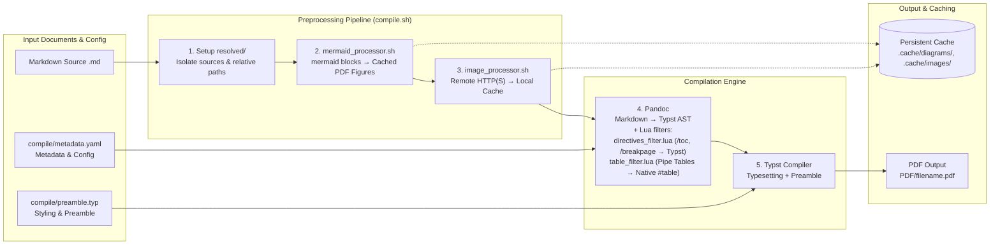

# MRKcompile

MRKcompile is a robust, modular document compilation pipeline that turns plain Markdown sources into professional, publication-quality typeset PDFs using **pandoc** and **Typst**, featuring automated **Mermaid diagram rendering** and **native Markdown table conversion**.

## Pipeline Architecture

The diagram below illustrates how `compile/compile.sh` orchestrates preprocessors, templates, and typesetting engines to compile documents:



## Quick Start

### Prerequisites
- **pandoc** (Markdown to Typst conversion)
- **typst** (PDF typesetting engine)
- **curl** (downloads remote images, used by `image_processor.sh`)
- **mmdc** (Mermaid CLI: `npm install -g @mermaid-js/mermaid-cli`, required only for diagrams)

### Building PDFs

Run the build script from the directory containing your `.md` files:

```bash
# Build all top-level *.md files in current directory
/path/to/MRKcompile/compile/compile.sh

# Build specific files
/path/to/MRKcompile/compile/compile.sh document.md

# Stitch and build files listed in a list file
/path/to/MRKcompile/compile/compile.sh -l list.txt

# Show help
/path/to/MRKcompile/compile/compile.sh --help    # also: -h
```

Outputs are generated in the `PDF/` directory.


## Documentation

- **Build Pipeline & Configuration:** See [`compile/README.md`](compile/README.md) for environment variables (`STRICT_MERMAID`, `KEEP_RESOLVED`, etc.), troubleshooting, and conventions.
- **Contributing & Principles:** See [`CONTRIBUTING.md`](CONTRIBUTING.md) for design philosophy (pristine sources, loud failures, deterministic caching).
