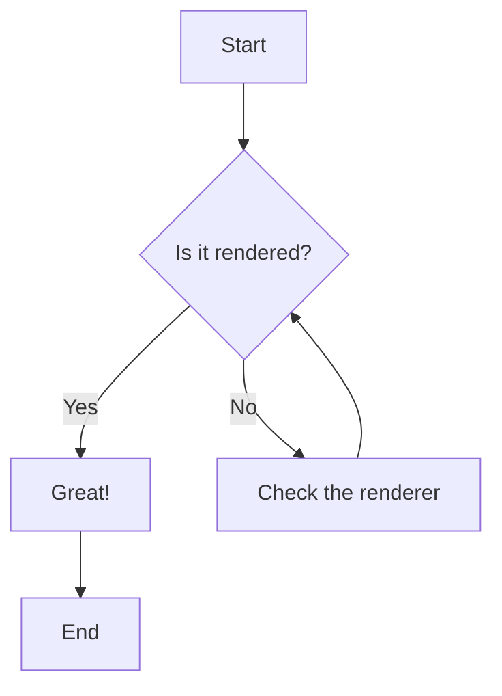
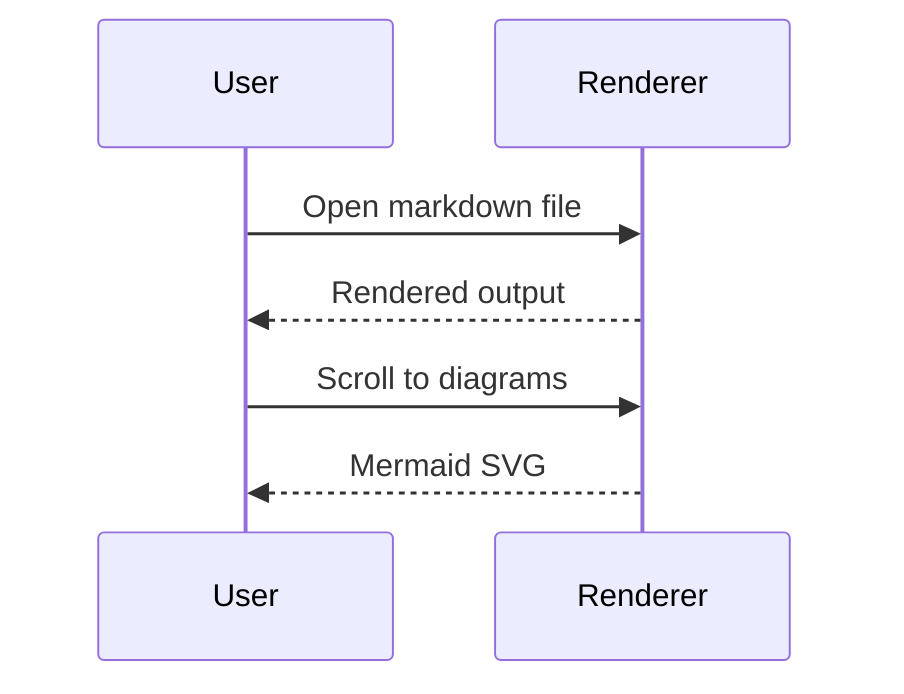

# Markdown Renderer Test 1: Basics

A quick smoke test. If this file renders correctly, the core features work.

**Checklist:** syntax highlighting, links, inline and block math, Mermaid diagrams.

---

## 1. Code Highlighting

Inline code: `const x = 42;` and `print("hi")`.

### Python

```python
def fibonacci(n: int) -> list[int]:
    """Return the first n Fibonacci numbers."""
    seq = [0, 1]
    while len(seq) < n:
        seq.append(seq[-1] + seq[-2])
    return seq[:n]

print(fibonacci(10))  # [0, 1, 1, 2, 3, 5, 8, 13, 21, 34]
```

### JavaScript

```javascript
const greet = async (name = "world") => {
  const res = await fetch(`https://example.com/api?q=${name}`);
  const { data } = await res.json();
  return `Hello, ${data.name}!`;
};
```

### Bash

```bash
#!/usr/bin/env bash
for f in *.md; do
  echo "Processing $f"
  wc -l "$f"
done
```

### JSON

```json
{
  "name": "test",
  "version": "1.0.0",
  "tags": ["markdown", "render"],
  "enabled": true,
  "count": null
}
```

---

## 2. Links

- Inline link: [Anthropic](https://www.anthropic.com)
- Link with title: [Markdown Guide](https://www.markdownguide.org "Hover title here")
- Autolink: <https://example.com>
- Bare URL: https://github.com
- Email autolink: <hello@example.com>
- Relative link: [Next test file](./02-intermediate.md)
- Anchor link: [Jump to math](#3-latex-math)
- Reference-style: [CommonMark][cm] and [GFM spec][gfm]

[cm]: https://commonmark.org
[gfm]: https://github.github.com/gfm/

---

## 3. LaTeX Math

Inline math: the area of a circle is $A = \pi r^2$, and Euler's identity is $e^{i\pi} + 1 = 0$.

Block math:

$$
\int_{-\infty}^{\infty} e^{-x^2} \, dx = \sqrt{\pi}
$$

The quadratic formula:

$$
x = \frac{-b \pm \sqrt{b^2 - 4ac}}{2a}
$$

A summation:

$$
\sum_{n=1}^{\infty} \frac{1}{n^2} = \frac{\pi^2}{6}
$$

---

## 4. Mermaid

### Flowchart



### Sequence diagram



---

## Expected Results

- [ ] Code blocks are colored per language (keywords, strings, comments differ)
- [ ] All links are clickable; the titled link shows a tooltip
- [ ] Inline math is inline; block math is centered on its own line
- [ ] The integral, fraction, and sum look like real typeset math
- [ ] Both Mermaid diagrams appear as graphics, not as code text
