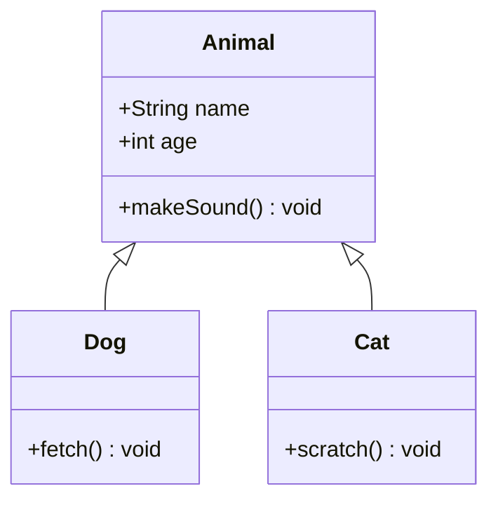
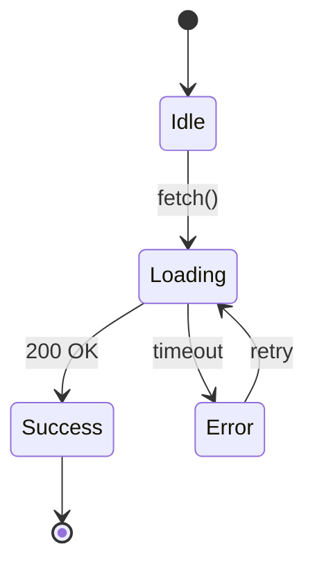
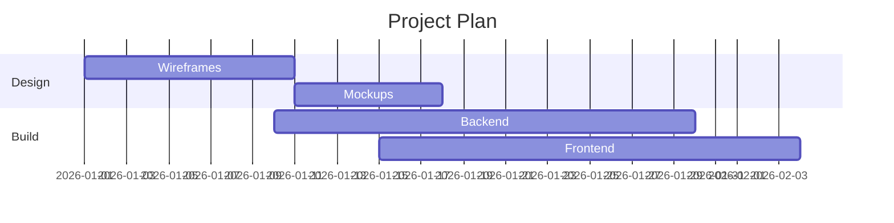
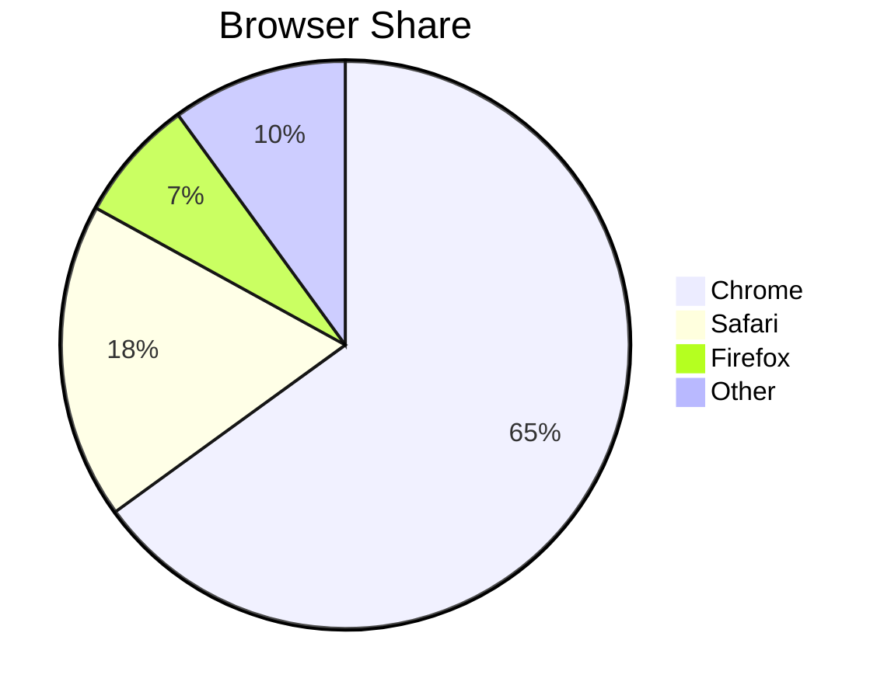
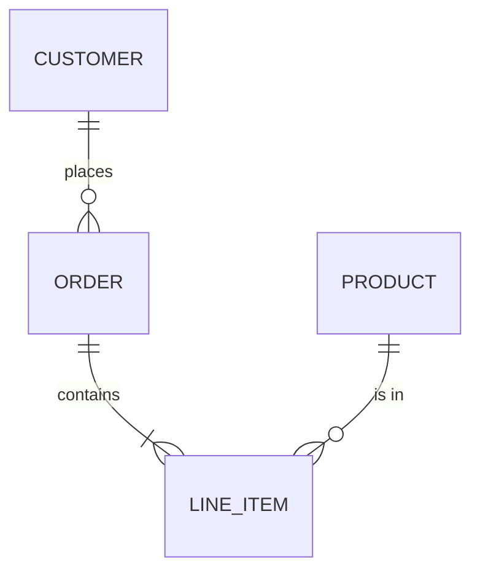

# Markdown Renderer Test 2: Intermediate

Tests more languages, richer math environments, more Mermaid diagram types, and features that often live alongside them (tables, footnotes, task lists).

---

## 1. Code Highlighting (Many Languages)

### Rust

```rust
use std::collections::HashMap;

#[derive(Debug, Clone)]
struct User {
    id: u32,
    name: String,
}

fn main() {
    let mut users: HashMap<u32, User> = HashMap::new();
    users.insert(1, User { id: 1, name: "Ada".into() });
    if let Some(u) = users.get(&1) {
        println!("Found {:?}", u);
    }
}
```

### TypeScript

```typescript
interface Point<T extends number = number> {
  x: T;
  y: T;
}

export function distance(a: Point, b: Point): number {
  return Math.hypot(a.x - b.x, a.y - b.y);
}
```

### SQL

```sql
SELECT u.name, COUNT(o.id) AS order_count
FROM users u
LEFT JOIN orders o ON o.user_id = u.id
WHERE u.created_at >= '2025-01-01'
GROUP BY u.name
HAVING COUNT(o.id) > 5
ORDER BY order_count DESC;
```

### Go

```go
package main

import "fmt"

func main() {
    ch := make(chan int)
    go func() { ch <- 42 }()
    fmt.Println(<-ch)
}
```

### HTML + CSS

```html
<div class="card" id="main">
  <h1 style="color: #333;">Title</h1>
  <!-- a comment -->
  <a href="https://example.com">Link</a>
</div>
```

```css
.card > h1:hover {
  color: rgb(255 0 128 / 80%);
  transition: all 0.3s ease-in-out;
}
```

### YAML and TOML

```yaml
services:
  web:
    image: nginx:latest
    ports:
      - "8080:80"
    environment:
      - DEBUG=true
```

```toml
[package]
name = "demo"
version = "0.1.0"

[dependencies]
serde = { version = "1.0", features = ["derive"] }
```

### Diff

```diff
- const old = "removed line";
+ const updated = "added line";
  const unchanged = true;
```

### Line with no language

```
Plain text block.
    Indentation   and   spacing   must   be   preserved.
No highlighting expected here.
```

---

## 2. Links

| Type | Example |
|------|---------|
| Inline | [Wikipedia](https://en.wikipedia.org/wiki/Markdown) |
| URL with parentheses | [Function (mathematics)](https://en.wikipedia.org/wiki/Function_(mathematics)) |
| URL with query | [Search](https://www.google.com/search?q=markdown+test&hl=en) |
| Link with code | [`npm install`](https://www.npmjs.com) |
| Bold link | **[Important](https://example.com)** |
| Image link | [](https://example.com) |

Footnote reference here[^1] and another one[^note].

[^1]: This is the first footnote, with a [link](https://example.com).
[^note]: A named footnote with `inline code`.

---

## 3. LaTeX Math

### Inline variety

Inline examples: $\alpha + \beta = \gamma$, $x_{i}^{2}$, $\sqrt[3]{27} = 3$, $\vec{v} \cdot \vec{w}$, $\mathbb{R}^n$, and $\lim_{x \to 0} \frac{\sin x}{x} = 1$.

### Aligned equations

$$
\begin{aligned}
(a + b)^2 &= a^2 + 2ab + b^2 \\
(a - b)^2 &= a^2 - 2ab + b^2 \\
(a + b)(a - b) &= a^2 - b^2
\end{aligned}
$$

### Matrices

$$
A = \begin{pmatrix}
1 & 2 & 3 \\
4 & 5 & 6 \\
7 & 8 & 9
\end{pmatrix}, \quad
\det(A) = \begin{vmatrix}
a & b \\
c & d
\end{vmatrix} = ad - bc
$$

### Piecewise function

$$
f(x) =
\begin{cases}
x^2 & \text{if } x \geq 0 \\
-x & \text{if } x < 0
\end{cases}
$$

### Maxwell's equations

$$
\begin{aligned}
\nabla \cdot \mathbf{E} &= \frac{\rho}{\varepsilon_0} \\
\nabla \cdot \mathbf{B} &= 0 \\
\nabla \times \mathbf{E} &= -\frac{\partial \mathbf{B}}{\partial t} \\
\nabla \times \mathbf{B} &= \mu_0 \mathbf{J} + \mu_0 \varepsilon_0 \frac{\partial \mathbf{E}}{\partial t}
\end{aligned}
$$

### Bayes and probability

$$
P(A \mid B) = \frac{P(B \mid A)\, P(A)}{P(B)}
$$

---

## 4. Mermaid (Many Diagram Types)

### Class diagram



### State diagram



### Gantt chart



### Pie chart



### Entity relationship



---

## 5. Misc Features

- [x] Completed task
- [ ] Pending task
- ~~Strikethrough text~~
- H~2~O and x^2^ (extended syntax; may not render everywhere)

> **Note:** a blockquote with `code`, a [link](https://example.com), and math $E = mc^2$.

---

## Expected Results

- [ ] Every language block has distinct token coloring; the diff shows red/green lines
- [ ] The no-language block stays monospaced with spacing intact
- [ ] The Wikipedia link with parentheses is not cut off at the first `)`
- [ ] Footnotes render with back-references
- [ ] Aligned equations line up on the `=` sign; matrices have brackets
- [ ] The piecewise function has a large left brace
- [ ] Five Mermaid diagrams render: class, state, Gantt, pie, ER
- [ ] Math inside the blockquote renders
