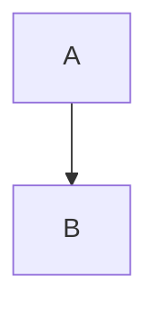
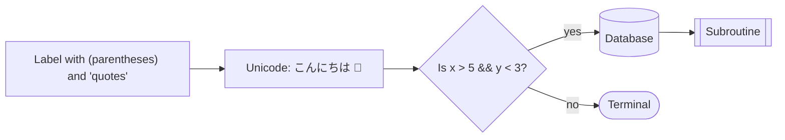
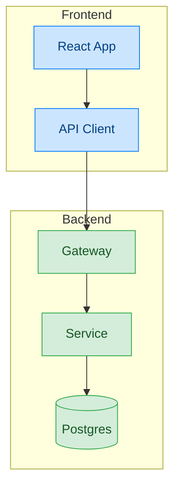
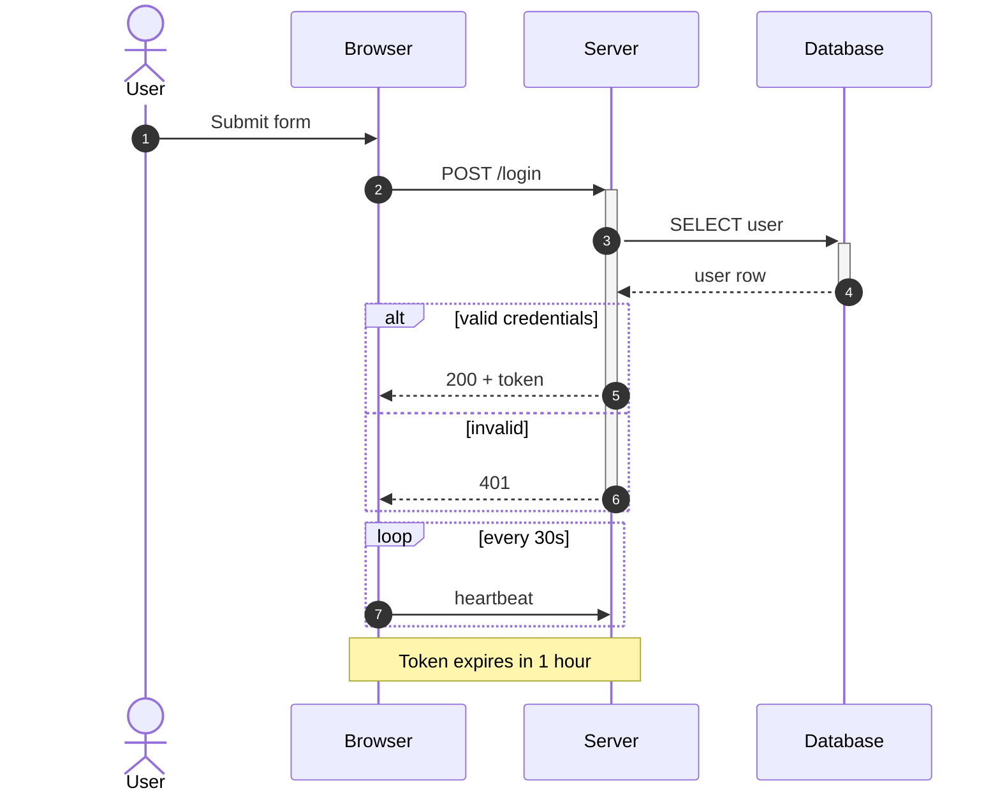
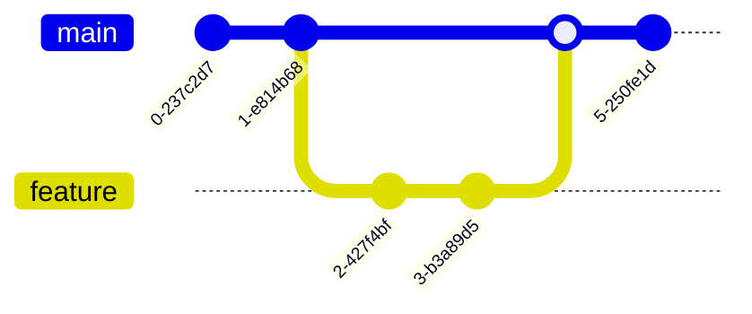
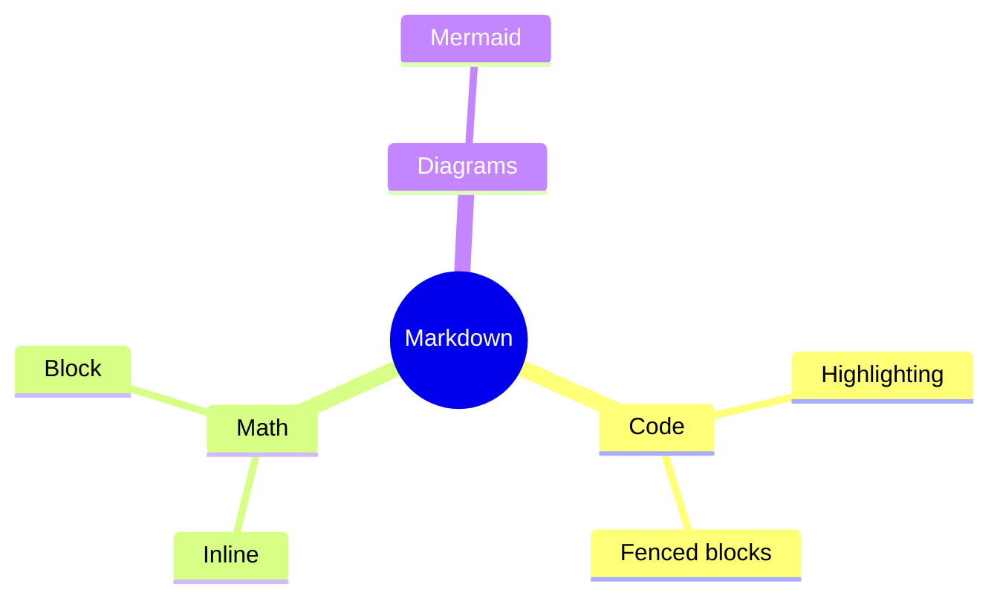

# Markdown Renderer Test 3: Stress Test and Edge Cases

This file targets the things renderers commonly get wrong. Some items are intentionally tricky. Read the "Expected" note under each section.

---

## 1. Code Blocks That Contain Other Syntax

Code containing math delimiters must NOT be rendered as math:

```python
price = "$5.00"
cost = "$10 and $20"
formula = r"$$ x^2 + y^2 = z^2 $$"
template = f"Total: ${total}"
```

Code containing a mermaid fence must display as plain text:

````markdown

````

Code containing markdown links and headings:

```markdown
# Not a real heading
[Not a link](https://example.com)
**Not bold**
```

Inline code with special characters: `` `backticks` inside ``, `<div>`, `$x^2$`, `\frac{a}{b}`.

Long line (should scroll or wrap, not break the layout):

```bash
curl -X POST "https://api.example.com/v1/resources?filter=active&sort=created_at&order=desc&limit=100&offset=0" -H "Authorization: Bearer $TOKEN" -H "Content-Type: application/json" -d '{"name":"a very long payload","description":"this line is intentionally long to test horizontal overflow handling in the renderer"}'
```

Unknown language and odd info strings:

```nonexistent-lang
this language does not exist; it should fall back to plain text
```

```js {1,3} title="example.js"
const a = 1;
const b = 2;
const c = 3;
```

Unicode and emoji inside code:

```python
# 日本語のコメント, émojis 🚀, Ελληνικά
greeting = "こんにちは 🌍"
```

Tabs vs spaces:

```go
func main() {
	if true {
		println("tab indented")
	}
}
```

**Expected:** no math or diagrams are rendered inside any of these blocks; everything appears as literal text.

---

## 2. Dollar Signs: Money vs Math

Prices must stay as text: it costs $5 and the other costs $10, so the total is $15.

Mixed case: the item is $20, and its area is $A = \pi r^2$ square meters.

Escaped dollar: \$100 should show a literal dollar sign, not start math.

Adjacent math: $a$, $b$, and $c$ are variables; $a+b=c$.

Spaces inside delimiters (many renderers refuse to treat these as math): $ x $.

**Expected:** "\$5 and the other costs \$10" stays plain text. `$A = \pi r^2$` renders as math.

---

## 3. Math in Awkward Places

### In a table

| Name | Formula | Value |
|------|---------|-------|
| Pythagoras | $a^2 + b^2 = c^2$ | classic |
| Golden ratio | $\varphi = \frac{1 + \sqrt{5}}{2}$ | $\approx 1.618$ |
| Pipe in math | $\lvert x \rvert$ | absolute value |

### In a list

1. First: $f(x) = x^2$
2. Second: $f'(x) = 2x$
   - Nested: $f''(x) = 2$
   - Nested block math:

     $$
     \int_0^1 x^2 \, dx = \frac{1}{3}
     $$

3. Third: $\displaystyle \sum_{k=0}^{n} k = \frac{n(n+1)}{2}$

### In a heading

#### Heading with math: $E = mc^2$

### In a blockquote

> The Gaussian integral:
>
> $$
> \int_{-\infty}^{\infty} e^{-x^2}\,dx = \sqrt{\pi}
> $$

### In bold and italics

**Bold with math $x^2$** and *italic with math $y^2$*.

### Special LaTeX commands

$$
\begin{align}
\mathcal{L}(\theta) &= \prod_{i=1}^{N} p(x_i \mid \theta) \\
\log \mathcal{L}(\theta) &= \sum_{i=1}^{N} \log p(x_i \mid \theta) \\
\hat{\theta}_{\text{MLE}} &= \underset{\theta}{\arg\max}\; \log \mathcal{L}(\theta)
\end{align}
$$

$$
\mathbf{F} = m\mathbf{a}, \qquad
\hbar \omega = E, \qquad
\binom{n}{k} = \frac{n!}{k!(n-k)!}, \qquad
\overbrace{1 + 2 + \cdots + n}^{n \text{ terms}}
$$

$$
\left\langle \psi \middle| \hat{H} \middle| \psi \right\rangle = E
$$

**Expected:** math renders inside tables, list items, headings, and quotes. Multi-line `align` aligns on `=`.

---

## 4. Links: Tricky Cases

- Parentheses in URL: [Wiki](https://en.wikipedia.org/wiki/Cant_(software))
- Angle-bracket URL with spaces: [Spaces](<https://example.com/a path/with spaces>)
- Fragment and query: [Anchor](https://example.com/page?x=1&y=2#section-3)
- Link text with brackets: [[bracketed]](https://example.com)
- Link wrapping inline code and emphasis: [**bold `code` link**](https://example.com)
- Same URL in many forms: https://example.com, <https://example.com>, [https://example.com](https://example.com)
- Trailing punctuation should not be swallowed: see https://example.com/page, or https://example.com/other.
- Footnote-style reference: [ref link][ref-1], and an implicit reference: [ref-1][]
- Heading anchor links: [Section 1](#1-code-blocks-that-contain-other-syntax), [Section 5](#5-mermaid-edge-cases)
- Dangerous scheme (should NOT be clickable or should be sanitized): [click me](javascript:alert('xss'))
- Non-http schemes: [mail](mailto:hello@example.com), [phone](tel:+15555550123)
- Link in a code span should NOT be linked: `[text](https://example.com)`

[ref-1]: https://example.com/reference "Reference Title"

**Expected:** all valid links clickable, the `javascript:` link is neutralized, and the code-span link stays plain.

---

## 5. Mermaid Edge Cases

### Special characters and quoted labels



### Subgraphs and styling



### Larger sequence diagram with loops and notes



### Git graph and mindmap





### Intentionally broken diagram

The next block has a syntax error. A good renderer shows a readable error message or falls back to the source, and the rest of the page still renders correctly.

```mermaid
flowchart TD
    A --> --> B
    this is not valid mermaid
```

**Expected:** all valid diagrams render, with colors and subgraphs intact. The broken diagram fails gracefully without breaking anything below it.

---

## 6. Content After the Broken Diagram

If you can read this, the renderer survived the error. The final formula should still render:

$$
e^{i\theta} = \cos\theta + i\sin\theta
$$

And this final code block should still be highlighted:

```python
print("Still alive after the broken diagram!")
```

---

## 7. Misc Edge Cases

Escaped characters: \*not italic\*, \_not italic\_, \`not code\`, \# not a heading, \[not a link\](url).

Underscores in words: snake_case_variable_name should not become italic.

Asterisks in math: $a * b$ and $a \ast b$.

Underscore-heavy math (the classic emphasis conflict): $x_1 + x_2 + \dots + x_n = \sum_i x_i$.

HTML passthrough: <kbd>Ctrl</kbd> + <kbd>C</kbd>, H<sub>2</sub>O, x<sup>2</sup>, <mark>highlighted</mark>.

<details>
<summary>Collapsible section (click to expand)</summary>

Hidden content with `code`, a [link](https://example.com), and math $x^2$.

```python
print("code inside details")
```

</details>

Horizontal rules in different forms:

---

***

___

Hard line break with two trailing spaces:  
second line.

---

## Final Expected Results

- [ ] Code blocks never trigger math or Mermaid rendering
- [ ] Prices with `$` are not mangled into math
- [ ] Math renders in tables, lists, headings, blockquotes, bold, and italic
- [ ] Underscores in math ($x_1 + x_2$) are not eaten by italics
- [ ] Tricky links work; `javascript:` is neutralized
- [ ] Mermaid special characters, subgraphs, styling, gitGraph, and mindmap render
- [ ] The broken Mermaid block fails gracefully and does not stop later content
- [ ] `<details>` collapses and its contents render when opened
