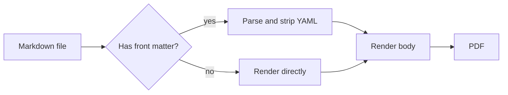

# Markdown Renderer Test 5: YAML Front Matter

The block above this heading, between the two `---` lines on lines 1 and 55 or so, is **YAML front matter**. It is metadata, not content.

## How to Check

Export this file to PDF, then **search the PDF text** (Ctrl+F or Cmd+F) for each of these strings:

| Search for | Should be found? |
|------------|:----------------:|
| `FRONTMATTER_SENTINEL` | **No** (zero matches, unless the renderer uses the title as a document title, see below) |
| `sentinel.one@example.com` | No |
| `FRONTMATTER_SENTINEL_DEEP_VALUE` | No |
| `FRONTMATTER_SENTINEL_HTML` | No |
| `draft: true` | No |
| `BODY_SENTINEL` | **Yes** (appears in the body below) |

**Allowed exception:** some tools deliberately use `title`, `author`, and `date` to build a title block or the PDF document properties. That is acceptable. It is **not** acceptable to see raw YAML such as `tags: [...]`, `config:`, or `abstract: |` as text, a table, a code block, or a heading.

---

## What a Broken Renderer Looks Like

Any of these at the top of the PDF means front matter handling is broken:

- Raw `key: value` lines shown as a paragraph
- The metadata shown as a code block
- The metadata shown as a table
- A horizontal rule at the top followed by one big heading made of the metadata (this happens when `---` after text is parsed as a setext heading underline)
- The `<script>` line appearing as text, or an alert popping up
- Math from the `abstract` or `formula` fields rendered as an equation
- The `price` value `$5.00` causing the following text to be treated as math

---

## Body Content (Must Render Normally)

BODY_SENTINEL: this paragraph must appear in the PDF. If the page starts here, with the H1 title above it, the metadata was stripped correctly.

### Code Highlighting

```python
def check(front_matter_hidden: bool) -> str:
    return "pass" if front_matter_hidden else "fail"
```

### Links

- [Pandoc metadata docs](https://pandoc.org/MANUAL.html#metadata-blocks)
- [Jekyll front matter](https://jekyllrb.com/docs/front-matter/)
- <https://example.com>

### Math

Inline: $a^2 + b^2 = c^2$.

$$
\int_0^1 x^2 \, dx = \frac{1}{3}
$$

### Mermaid



---

## Tricky Cases: Content That Looks Like Front Matter

These body elements must still render as **body content**, even though they resemble front matter.

### 1. Horizontal rule between paragraphs

Paragraph above the rule.

---

Paragraph below the rule. A horizontal line should be visible between the two paragraphs.

### 2. A second `---` ... `---` block in the body

The next block is NOT at the top of the file, so it is not front matter. It should render as: a rule, a paragraph, then another rule.

---

title: this is not metadata
author: it is just text between two rules

---

**Expected:** two horizontal rules with the two `key: value` lines visible between them. (In some parsers the first line followed by `---` becomes a heading; either way the text should be visible, not silently removed.)

### 3. A YAML code block in the body

This one SHOULD be visible, highlighted as YAML:

```yaml
---
title: Visible example front matter
tags: [one, two, three]
nested:
  key: value
---
```

### 4. Front matter shown as an example inside a markdown fence

````markdown
---
title: Example inside a fence
---

# Heading inside a fence
````

**Expected:** shown literally as code, not parsed.

### 5. Text immediately followed by dashes (setext heading)

Setext heading text
-------------------

The line above should render as an H2 heading, which is normal Markdown behavior and different from front matter.

### 6. Table with dashes

| Key | Value |
|-----|-------|
| title | normal table cell |
| draft | also normal |

---

## Final Checklist

- [ ] PDF does not show `tags:`, `config:`, `abstract:`, `author:` lines as text
- [ ] Searching the PDF for `FRONTMATTER_SENTINEL` returns nothing (or only a title block / PDF properties if the tool uses them)
- [ ] No `<script>` text and no alert from the `html` field
- [ ] Math from the metadata did not render as an equation
- [ ] The page begins with the H1 "Markdown Renderer Test 5", not a block of metadata
- [ ] `BODY_SENTINEL` is found in the PDF text
- [ ] Code highlighting, link, math, and Mermaid below the metadata still work
- [ ] A rule in the body renders as a rule, not as front matter
- [ ] The body `---` block (case 2) is visible, not swallowed as metadata
- [ ] The YAML fenced block (case 3) is visible and highlighted
- [ ] The fenced markdown example (case 4) is literal code
- [ ] Setext heading (case 5) renders as an H2
